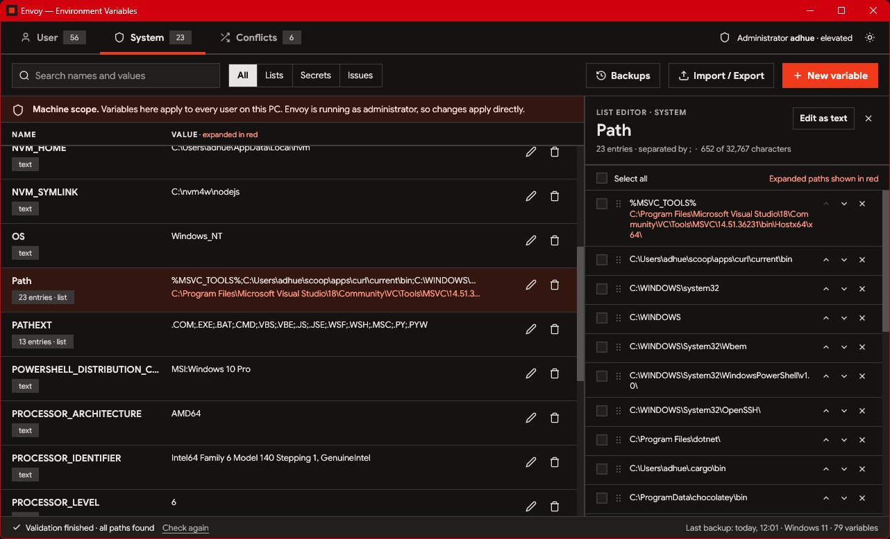
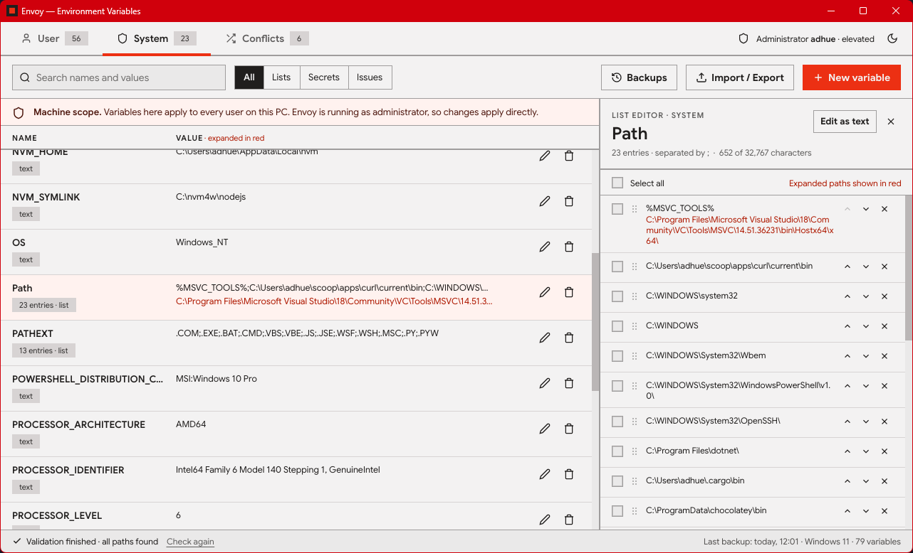

# Envoy

A Windows environment variable manager made in Rust with [egui](https://github.com/emilk/egui).

The built-in Windows editor stops at 2,047 characters per variable. Windows itself
stores up to 32,767, so Envoy reads and writes the registry directly and treats
list variables such as `Path` as first-class lists.





```
cargo run --release
```

Windows only. Needs a recent stable Rust toolchain (edition 2024). The release build
embeds the app icon and version info into `envoy.exe` through `build.rs` (`winres`).

## What it does

- **User / System / Conflicts tabs.** Conflicts lists names defined in both scopes
  and which value wins (the user value, except `PATH`, which is system + user).
- **Variable table.** Raw value with the `%VAR%` expansion underneath in red.
  Secrets are masked until revealed. Search, plus All / Lists / Secrets / Issues filters.
- **List editor.** Check, reorder (arrows or drag the grip), remove and add entries.
  "Move to new variable" splits selected entries into their own variable and
  leaves a `%NAME%` reference in their place.
- **Background validation.** Folders that do not exist, references to undefined
  variables and duplicate entries are flagged on rows and entries.
- **Pending changes.** Nothing is written until *Apply changes*. Only the variables
  that differ are written, a backup is taken first, and `WM_SETTINGCHANGE` is
  broadcast afterwards so new processes see the update.
- **Import / Export** as `.json`, `.env`, `.reg`, or a PowerShell script (export only).
- **Backups** under `%APPDATA%\Envoy\backups`; restoring stages the snapshot as
  pending changes.

## Elevation

User variables never need elevation. Applying system changes from a normal
session shows one UAC prompt: Envoy starts an elevated copy of itself
(`envoy.exe --apply-elevated <file>`) that writes just those changes and exits.
"Run as administrator" restarts the whole app elevated and carries pending edits over.

## Layout

| File | Role |
| --- | --- |
| `model.rs` | Variables, scopes, diff / rebase, `%VAR%` expansion |
| `winenv.rs` | Registry access, UAC, change broadcast |
| `store.rs` | Settings and backups in `%APPDATA%\Envoy` |
| `transfer.rs` | Import / export formats |
| `validate.rs` | Background path checks |
| `app.rs` | State and everything that mutates it |
| `views.rs`, `dialogs.rs` | Screens and modal dialogs |
| `theme.rs`, `widgets.rs` | Palette (light and dark), fonts, icons, custom controls |
| `build.rs` | Embeds `assets/envoy.ico` and version info into the exe |

`cargo test` runs the unit tests. `cargo test -- --ignored` additionally writes and
removes a throwaway user variable in the real registry.

## Fonts and icon

The UI uses Google Sans throughout. It is a variable font, so one file
(`assets/fonts/GoogleSans-VariableFont_GRAD,opsz,wght.ttf`) serves every weight:
400 for text, 600 for labels and 700 for headings and buttons. The weights are set in
`install_fonts` in `theme.rs`.

`assets/envoy.ico` is the exe icon. The window icon is drawn in code by `app_icon()`
in `main.rs`; keep the two in sync if you change either.

## License

Envoy is released under the MIT license; see `LICENSE.txt`.

Google Sans (`assets/fonts`) is used under the SIL Open Font License 1.1; the license
text is in `assets/fonts/OFL.txt`.
